{width="700" fig-align="center"}

Para consultar este material escanea el QR o visita este enlace:

https://freddy-hb-tidymodels-latinr.share.connect.posit.cloud/

{width="150" fig-align="center"}

# Ecosistema tidymodels

Bienvenidos al taller práctico sobre **tidymodels**, un paquete en R diseñado para modelado y aprendizaje automático (machine learning) utilizando los principios de tidyverse.

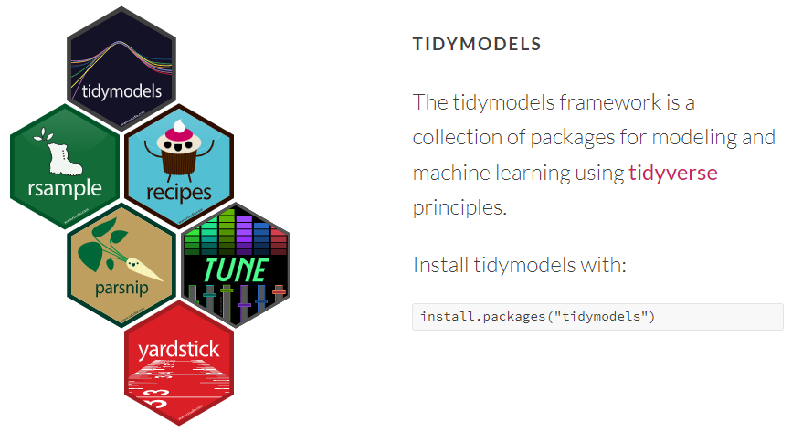{width="800" fig-align="center"}

## Ventajas de tidymodels

- **Sintaxis unificada:** proporciona una interfaz consistente (**parsnip**) para entrenar cientos de modelos de Machine Learning (regresión lineal, árboles de decisión, random forest, XGBoost, etc.) sin tener que aprender la sintaxis nativa de cada paquete específico.
- **Diseño modular:**cada tarea del flujo de trabajo (dividir datos, limpiar, entrenar, evaluar) cuenta con un paquete especializado y cohesivo.
- **Integración con Tidyverse:** se integra perfectamente con pipes (`|>` o `|>`), estructuras de datos tipo `tibble` y funciones de manipulación de datos habituales.
- **Prevención de fuga de datos:** gracias al uso de **recipes** y **workflows**, el preprocesamiento de datos se calcula únicamente sobre los conjuntos de entrenamiento, aplicando las mismas transformaciones de forma segura en validación o prueba.

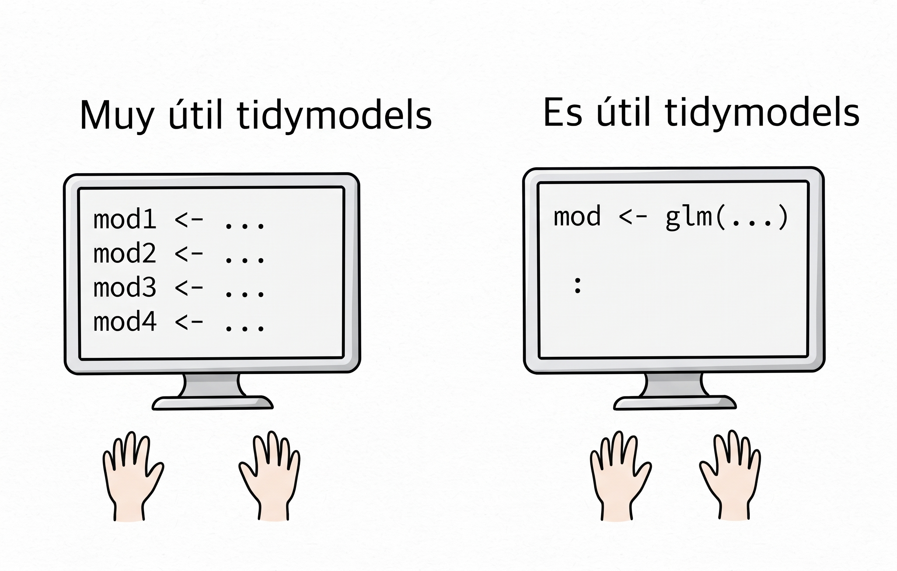{width="600" fig-align="center"}

A continuación tenemos un ejemplo de tres random forests para regresión utilizando tres paquetes diferentes:

```{r}
#| eval: false
# From randomForest
rf_1 <- randomForest(
  y ~ ., 
  data = dat, 
  mtry = 10, 
  ntree = 2000
)

# From ranger
rf_2 <- ranger(
  y ~ ., 
  data = dat, 
  mtry = 10, 
  num.trees = 2000
)

# From sparklyr
rf_3 <- ml_random_forest(
  dat, 
  intercept = FALSE, 
  response = "y", 
  features = names(dat)[names(dat) != "y"], 
  col.sample.rate = 10,
  num.trees = 2000
)
```

Tener que memorizar tantos nombres de parámetros y diferentes formas de ingresar los datos es estresante.

{width="300" fig-align="center"}

## Material para aprender sobre tidymodels

Existe un extenso material en la web que se puede utilizar para aprender sobre tidymodels.

### Página web <https://www.tidymodels.org> {.unnumbered}

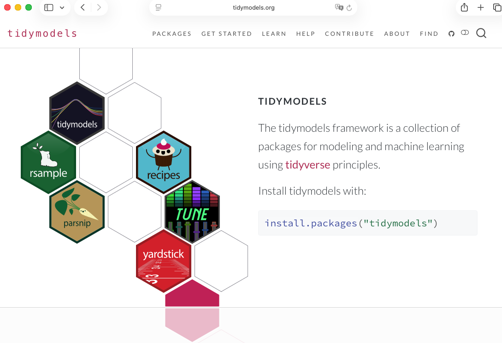{width="600" fig-align="center"}

<br><br>

### Libro "Tidy Modeling with R" {.unnumbered}

El libro se puede consultar en <https://www.tmwr.org>.

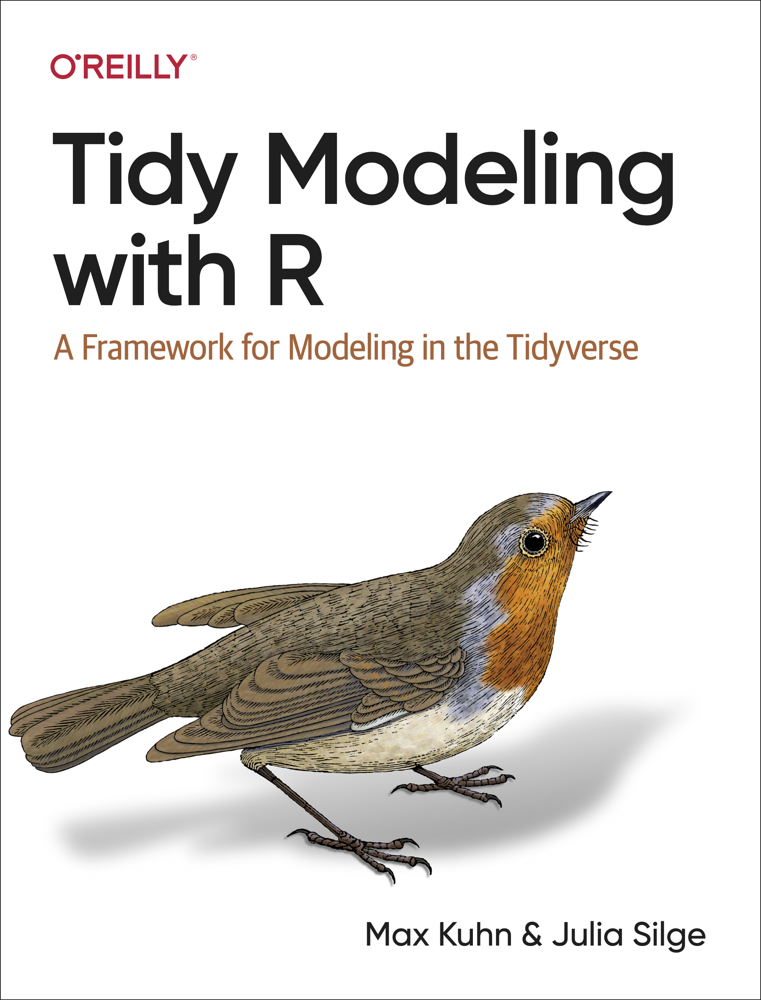{width="400" fig-align="center"}

<br><br>

### Libro "Machine Learning with Tidymodels" {.unnumbered}

El libro se puede consultar en <https://gedeck.github.io/machine-learning-with-tidymodels/>.

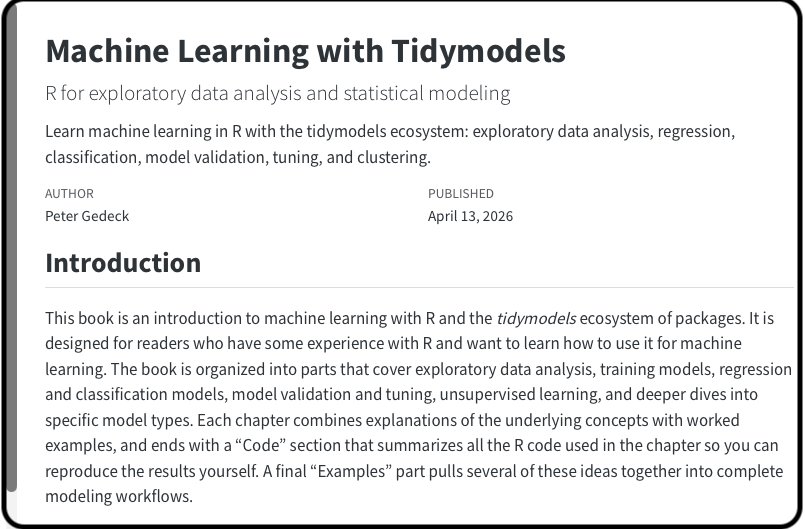{width="600" fig-align="center"}

### Video tidymodels en 39 minutos {.unnumbered}



## Equipo desarrollador de tidymodels

El equipo de trabajo de tidymodels tiene a varios colaboradores que se pueden consultar en [este enlace](https://www.tidymodels.org/about/).

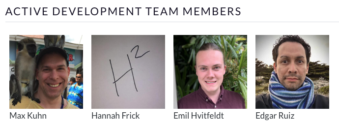{width="800" fig-align="center"}

## Instalación y carga

Se puede instalar paquete por paquete o todo el ecosistema de tidymodels de la siguiente manera:

```{r}
#| eval: false
#| echo: true
install.packages("tidymodels")
library(tidymodels)
```

```{r}
#| echo: false
library(tidymodels)
```

## Cheat sheets

Todos los paquetes de tidymodels tienen una hoja de trucos (cheat sheets) que contiene explicaciones de las funciones más importantes de cada paquete. Consultarlas es una forma rápida para entender la utilidad de cada paquete.

En el siguiente enlace se pueden consultar todas las hojas de trucos.

<https://www.tidymodels.org/cheatsheets/>

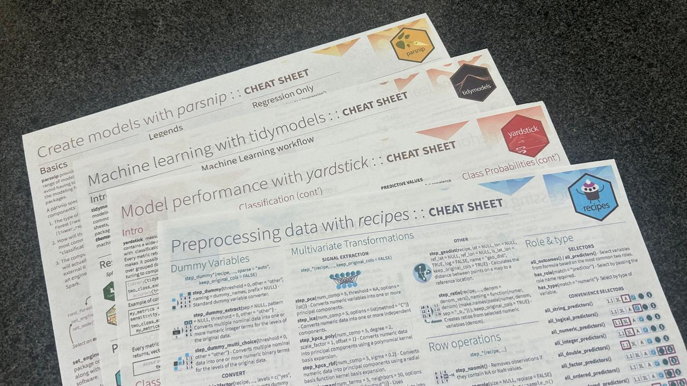{width="800" fig-align="center"}

------------------------------------------------------------------------

# Estructura del tutorial

El tutorial tendrá las siguientes actividades:

1. 👀 🧠 Mirar y analizar  códigos para realizar una tarea.
2. ✍🏽 Completar códigos para realizar una tarea. El documento de word con las preguntas y códigos está disponible en este [enlace](https://github.com/fhernanb/taller_tidymodels_latinR/blob/main/taller_practico_penguins_tidymodels.docx). Para descargar el documento de word debe dar click en las palabras "View raw".
3. 🧨 Las respuestas a las preguntas del documento de word están en este [enlace](https://github.com/fhernanb/taller_tidymodels_latinR/blob/main/solucion_taller_penguins.R). Revise la solución solo cuando usted ya tenga una respuesta.

{width="400" fig-align="center"}

{width="400" fig-align="center"}

------------------------------------------------------------------------

# Datos de ejemplo (*toy data*)

En esta sección vamos a mostrar los datos que vamos a utilizar como ejemplo. La idea de estos datos sencillos y con pocas observaciones y variables, es que podamos ver la utilidad de las funciones sin que los datos se roben el protagonismo.

```{r}
gen_dat <- function(n) {
  dni <- round(10000000 * runif(n=n), digits=6)
  dni <- as.integer(dni)
  exp <- rpois(n, lambda=10)                    # Cuanti 1 (Predictora)
  edad <- sample(22:65, n, replace = TRUE)      # Cuanti 2 (Predictora)
  educa <- factor(sample(c("Posgrado", "Univ", "Tecnico"), 
                        n, replace = TRUE),
                 levels=c("Tecnico", "Univ", "Posgrado")) # Cuali 1 (Predictora)
  depto <- factor(sample(c("Ventas", "IT", "Finanzas"), 
                        n, replace = TRUE),
                  levels=c("Ventas", "IT", "Finanzas")) # Cuali 2 (Predictora)
  
  # Creando la variable respuesta
  media <- 3 + 5 * edad + 2 * exp + 
    3 * (depto == "IT") + 
    4 * (depto == "Finanzas") +
    10 * (educa == "Univ") + 
    15 * (educa == "Posgrado")
  
  salario <- rnorm(n = n, mean = media, sd = 10)  # Variable Respuesta
  
  datos <- data.frame(exp = exp, edad = edad, 
                      educa = educa, depto = depto, 
                      dni = dni, salario = salario)
}

set.seed(123)
datos <- gen_dat(n=10)
datos
```

Exploremos la estructura de nuestros datos.

```{r}
glimpse(datos)
```

{width="150"}

::: callout-tip
## Objetivo

Crear un modelo de regresión (estadístico o ML) para predecir el salario en función de los predictores.
:::

------------------------------------------------------------------------

# recipes

{width="100"}

El paquete **recipes** se utiliza para el preprocesamiento y *feature engineering*. Permite definir una serie de pasos secuenciales (normalizar variables numéricas, imputar valores faltantes, crear variables dummy, etc.) antes de crear un modelo estadístico o un modelo de machine learning.

::: callout-tip
## Tip
Ver el siguiente video para profundizar.
:::



Veamos un ejemplo de la receta para una torta o pastel de zanahoria.

{width="500" fig-align="center"}

La función `recipe()` nos permite crear recetas para un modelo de interés, la estructura básica de la función es:

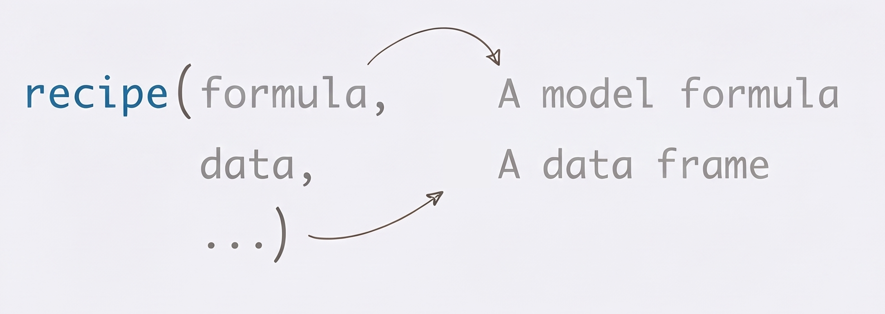{width="500" fig-align="center"}

Para completar una receta es necesario procesar los ingredientes, y es ahí donde 
las funciones `step_algo` de **recipes** que hacen transformaciones sobre las variables, algunas de ellas son:

- `step_range(min=0, max=1)`: convierte al intervalo \[0, 1\].
- `step_center()`: convierte la variable para que tenga media 0.
- `step_normalize()`: convierte la variable para que tenga media 0 y varianza 1.
- `step_sqrt()`: aplica $\sqrt{.}$.
- `step_log()`: aplicar $\log(.)$.
- ...
- `step_impute_bag()`
- `step_impute_knn()`
- `step_impute_linear()`
- ...

Existen las funciones "selectors" o seleccionadores de variables, algunas de ellas son:

- `all_outcomes()`
- `all_predictors()`
- `all_numeric_predictors()`
- `all_factor_predictors()`
- `all_nominal()`
- `all_numeric()`
- `has_role()`
- `has_type()`
- `dplyr::select()`

## Ejemplo básico

Vamos a crear la receta para el modelo de interés.

```{r}
rec1 <- recipe(salario ~ ., data=datos) |> 
  update_role(dni, new_role="ID") |> 
  step_range(edad, min=0, max=1) |> 
  step_sqrt(exp) |> 
  step_dummy(all_factor_predictors())

class(rec1)
rec1
```

Ahora vamos a "preparar" la receta.

```{r}
pr1 <- prep(rec1, training=datos)

class(pr1)
pr1
```

Ahora vamos a "hornear" o crear un conjunto de datos nuevos usando la información de la receta "preparada".

```{r}
bake(pr1, new_data=datos)
```

## Ejemplo con datos faltantes NA

El paquete recipes tiene unas funciones para hacer imputación datos. Vamos a crear una copia de los datos y vamos a introducir manualmente unos NA's para ver como hacer la imputación.

```{r}
datos2 <- datos
datos2$exp[c(1, 2)]   <- NA
datos2$educa[c(3, 4)] <- NA
datos2
```

Hay varias funciones para imputar datos faltantes, aquí vamos a usar dos de ellas, `step_impute_bag` y `step_impute_knn`.

```{r}
rec2 <- recipe(salario ~ ., data = datos2) |>
  step_impute_bag(educa) |> 
  step_impute_knn(exp)

pr2 <- prep(rec2, training = datos2)

bake(pr2, new_data = datos2)
```

Comparemos con la base de datos que NO tiene los NA's.

```{r}
datos
```

## Ejemplo con términos de interacción

Es posible incluir términos de interacción usando la función `step_interact()`. A continuación un ejemplo.

```{r}
rec3 <- recipe(salario ~ ., data = datos) |>
  update_role(dni, new_role="ID") |> 
  step_dummy(all_factor_predictors()) |> 
  step_interact(~ edad:starts_with("depto_"))

pr3 <- prep(rec3, training = datos)

bake(pr3, new_data = datos)
```

------------------------------------------------------------------------

# rsample

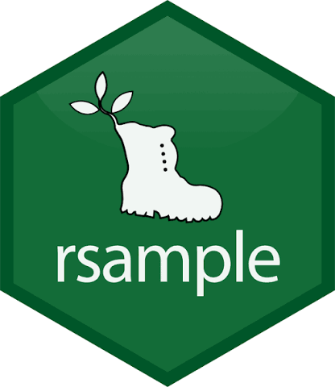{width="100"}

El paquete **rsample** gestiona la creación de muestras de datos para validación y evaluación, facilitando particiones comunes como entrenamiento/prueba (*train/test splits*) y esquemas de validación cruzada (*cross-validation*).

::: callout-tip
## Tip

Ver el siguiente video para profundizar.
:::



## Función principal {.unnumbered}

```{r}
#| eval: false
initial_split(data,          # A data frame  
              prop = 3/4,    # The proportion for train data
              strata = NULL, # A variable in data
              ...)
```

::: callout-warning
## strata

A variable in data (single character or name) used to conduct stratified sampling. When not NULL, each resample is created within the stratification variable. Numeric strata are binned into quartiles.
:::

## Ejemplo sin usar `strata`

Vamos a dividir nuestros datos en datos entrenamiento (60%) y datos de prueba (40%).

```{r}
split_inf <- initial_split(datos, prop = 0.60)
split_inf
```

Usando la información de la partición que están en el objeto `split_inf`, podemos ahora si crear los dos conjuntos de datos nuevos.

```{r}
train_data <- training(split_inf)
test_data  <- testing(split_inf)
```

Ahora comparemos los datos originales y las particiones.

```{r}
datos
train_data
test_data
```

## Ejemplo usando `strata` con variable cualitativa

¿Qué sucede si usamos el argumento `strata`?

```{r}
split_inf <- initial_split(datos, strata = educa, prop = 0.60)
split_inf
train_data <- training(split_inf)
test_data  <- testing(split_inf)
train_data
test_data
```

## Ejemplo usando `strata` con variable cuantitativa

¿Qué sucede si usamos el argumento `strata`?

```{r}
split_inf <- initial_split(datos, strata = salario, prop = 0.60)
split_inf
train_data <- training(split_inf)
test_data  <- testing(split_inf)
train_data
test_data
```

<br><br>

{width="300"}

Realice los ejercicios 1, 2 y 3 del [taller de word](https://github.com/fhernanb/taller_tidymodels_latinR/blob/main/taller_practico_penguins_tidymodels.docx).

<br><br>

------------------------------------------------------------------------

# parsnip

{width="100"}

El paquete **parsnip** unifica la interfaz de construcción de modelos de aprendizaje automático. En lugar de recordar la sintaxis específica de paquetes como **stats**, **randomForest** o **xgboost**, se declara el modelo, el motor (*engine*) y el modo de tarea.

La estructura para especificar un modelo es la siguiente:

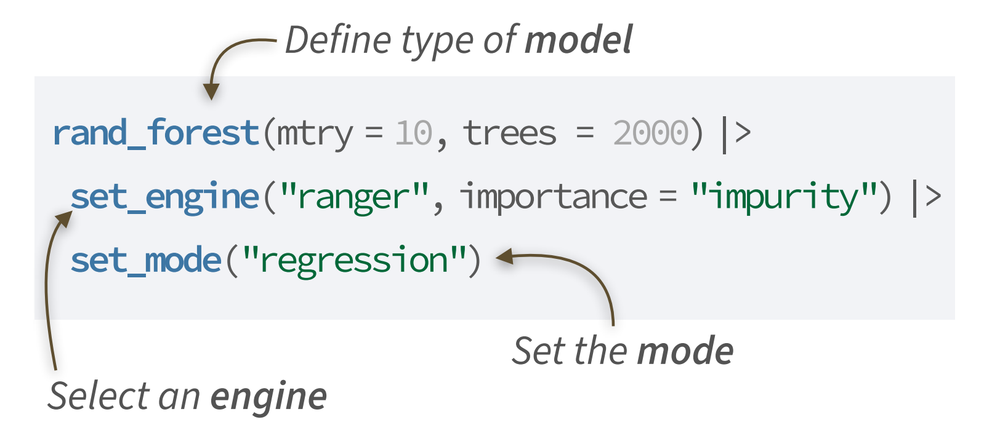{width="500" fig-align="center"}

¿Existe un listado de los modelos implementados en tidymodels?

Sí, existe una herramienta interactiva con filtros para seleccionar el modelo de interés, la url a visitar es <https://www.tidymodels.org/find/parsnip/>.

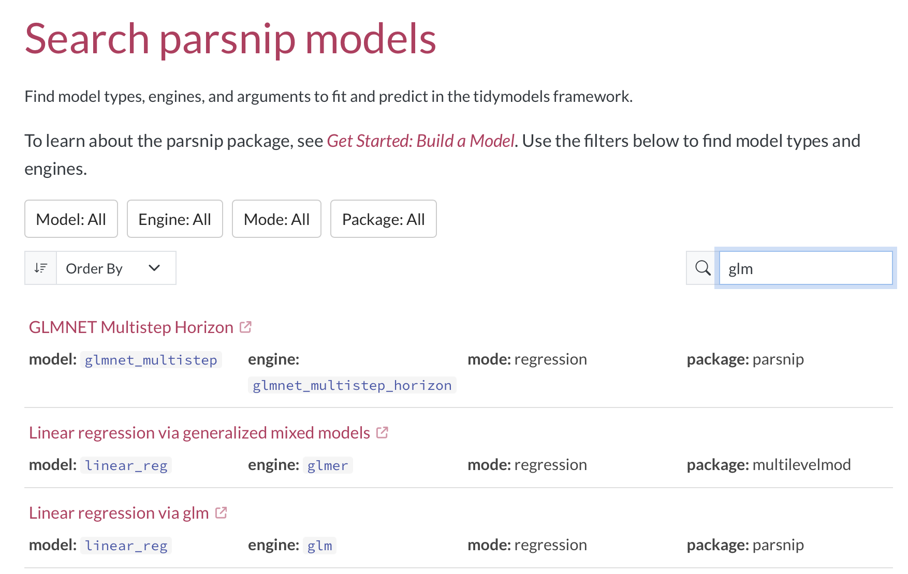{width="800" fig-align="center"}

## Ejemplo básico

Vamos a definir tres especificaciones de modelo: una regresión lineal, un modelo lineal generalizado (respuesta gamma y enlace log) y un random forest.

```{r}
# Regresion lineal
lm_spec <- linear_reg() |>  
  set_engine("lm") |> 
  set_mode("regression")

# Modelo lineal generalizado
glm_spec <- linear_reg() |>  
  set_engine("glm", family = stats::Gamma(link = "log")) |> 
  set_mode("regression")

# Random forest
rf_spec <- 
  rand_forest() |> 
  set_engine("ranger") |> 
  set_mode("regression")
```

<br><br>

{width="300"}

Realice el ejercicio 4 del [taller de word](https://github.com/fhernanb/taller_tidymodels_latinR/blob/main/taller_practico_penguins_tidymodels.docx).

<br><br>

------------------------------------------------------------------------

# workflows

{width="100"}

El paquete **workflows** (o flujos de trabajo) sirve para automatizar, organizar y conectar tareas repetitivas en un orden específico.

La estructura básica de un flujo de trabajo se muestra a continuación. El objeto `xx_spec` se reemplaza por una las especificaciones que se hayan definido antes: `lm_spec`, `glm_spec` o `rf_spec`. Dependiendo de la especificación usada, el nombre del flujo `xx_wflow` cambia. Por ejemplo, si usamos el la especifiación `glm_spec`, entonces el flujo lo podemos llamar `glm_wflow`.

```{r}
#| eval: false
#| # Create a workflow
xx_wflow <- workflow() |> 
  add_recipe(rec1) |> 
  add_model(xx_spec)

# Fit the model
xx_fit <- fit(xx_wflow, data=train_data)
```

## Ejemplo básico

Vamos a crear los tres flujos y a entrenar los tres modelos especificados anteriormente.

```{r}
# Vamos a aumentar la cantidad de datos para poder entrenar bien
set.seed(123)
datos <- gen_dat(n=1000)
split_inf <- initial_split(datos, strata = salario, prop = 0.60)
train_data <- training(split_inf)
test_data  <- testing(split_inf)

# Create the workflow
lm_wflow <- workflow() |> 
  add_recipe(rec1) |> 
  add_model(lm_spec)

glm_wflow <- workflow() |> 
  add_recipe(rec1) |> 
  add_model(glm_spec)

rf_wflow <- workflow() |> 
  add_recipe(rec1) |> 
  add_model(rf_spec)

# Fit the model
 lm_fit <- fit(lm_wflow, data=train_data)
glm_fit <- fit(glm_wflow, data=train_data)
 rf_fit <- fit(rf_wflow, data=train_data)
```

Ahora vamos a predecir la variable de interés usando train y usando test para uno de los modelos entrenados.

```{r}
lm_fit |> 
  predict(new_data = train_data)

lm_fit |> 
  predict(new_data = test_data)
```

## Ejemplo básico - Estimando con nueva información

Ahora vamos a ver cómo estimar la variable de interés para unos datos nuevos.

```{r}
nuevo <- data.frame(exp=c(5, 8, 3),
                    edad=c(20, 29, 31),
                    educa=c("Tecnico", "Univ", "Posgrado"),
                    depto=c("IT", "Finanzas", "Ventas"),
                    dni=c(1, 2, 3))
lm_fit |> 
  predict(new_data = nuevo)
```

{width="50"}

¿Será posible resumir las predicciones anteriores en un número para evaluar si el modelo realiza bien su trabajo de predicción?

Rta: sí.

<br><br>

{width="300"}

Realice el ejercicio 5 del [taller de word](https://github.com/fhernanb/taller_tidymodels_latinR/blob/main/taller_practico_penguins_tidymodels.docx).

<br><br>

------------------------------------------------------------------------

# yardstick

{width="100"}

El paquete **yardstick** calcula las métricas de rendimiento para evaluar qué tan bien se desempeñan los modelos (por ejemplo: exactitud, sensibilidad, especificidad, AUC-ROC para clasificación, o RMSE, R-cuadrado para regresión).

En la hoja de trucos del paquete podemos encontrar muchas métricas, algunas de ellas se muestran en la siguiente figura:

::: {layout-ncol="2"}
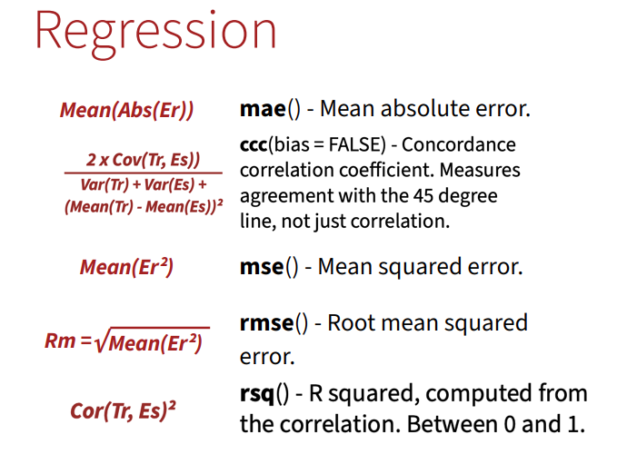

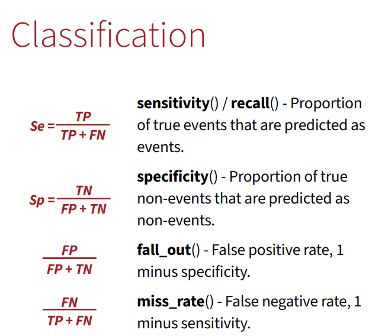
:::

## Ejemplo básico

Calcular las métricas Rsq y MSE para las predicciones obtenidas con los datos de entrenamiento y usando los modelos entrenados.

```{r}
lm_results <- 
  lm_fit |> 
  predict(new_data = train_data) |> 
  mutate(truth = train_data$salario)

my_metrics <- metric_set(rsq, mse)

lm_results |> 
  my_metrics(truth = truth, estimate = .pred)
```

```{r}
glm_results <- 
  glm_fit |> 
  predict(new_data = train_data) |> 
  mutate(truth = train_data$salario)

my_metrics <- metric_set(rsq, mse)

glm_results |> 
  my_metrics(truth = truth, estimate = .pred)
```

```{r}
rf_results <- 
  rf_fit |> 
  predict(new_data = train_data) |> 
  mutate(truth = train_data$salario)

my_metrics <- metric_set(rsq, mse)

rf_results |> 
  my_metrics(truth = truth, estimate = .pred)
```

{width="50"}

¿Será que podemos confiar en estos resultados puntuales o podemos hacer algo adicional?

------------------------------------------------------------------------

# Remuestreo - validación cruzada

{width="100"} {width="100"}

Los métodos de remuestreo permiten evaluar de forma fiable el rendimiento de un modelo y ajustar sus hiperparámetros utilizando repetidamente subconjuntos de los datos de entrenamiento para evitar el sobreajuste.

A continuación se muestran algunos de los tipos de remuestro que se pueden utilizar.

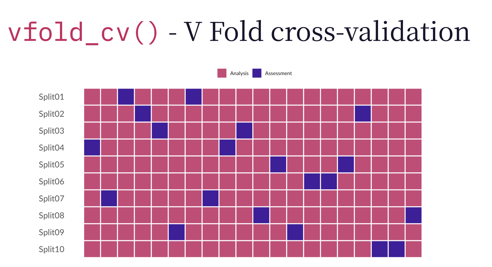{width="700" fig-align="center"} 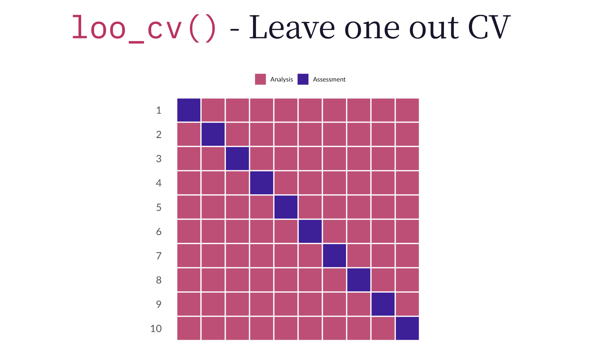{width="700" fig-align="center"} 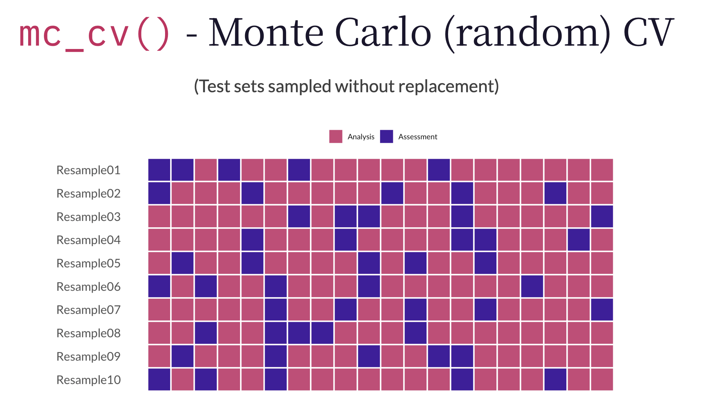{width="700" fig-align="center"} 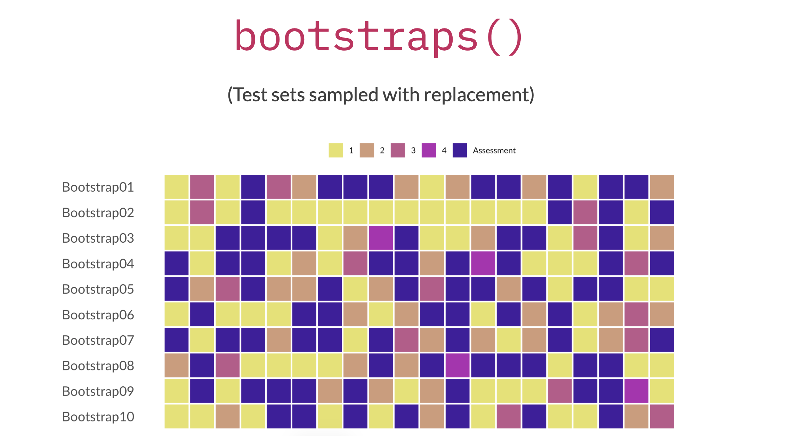{width="700" fig-align="center"}

## Ejemplo básico

Vamos a explorar el uso de la función `vfold_cv` sin y con el argumento `strata`.

```{r}
# Sin usar strata
set.seed(100) # Important!
folds <- vfold_cv(data = train_data, v = 10)
folds
```

```{r}
# Usando strata = variable respuesta
set.seed(100) # Important!
folds <- vfold_cv(data = train_data, v = 10, 
                  strata = salario, breaks = 4)
folds
```

{width="50"}

¿Se puede usar `fit()` para entrenar un modelo cuando tenemos cross-validation?

Rta: no.

La función `fit_resamples()` del paquete **tune** es la función que nos ayudará a ajustar modelos con remuestreo. Los argumentos más importantes de la función son:

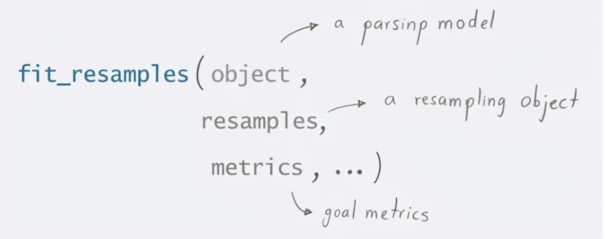{width="700" fig-align="center"}

## Ejemplo básico

Vamos a crear una partición con `vfold_cv()` y luego vamos a utilizar `fit_resamples()` para el primer modelo.

```{r}
lm_results <-
  lm_wflow |> 
  fit_resamples(resamples = folds,
                metrics = metric_set(rsq, mse))

lm_results |> 
  collect_metrics(summarize = FALSE)

lm_results |> 
  collect_metrics(summarize = TRUE)
```

Ahora vamos a realizar lo anterior para los otros dos modelos.

```{r}
glm_results <-
  glm_wflow |> 
  fit_resamples(resamples = folds,
                metrics = metric_set(rsq, mse))

glm_results |> 
  collect_metrics(summarize = TRUE)
```

```{r}
rf_results <-
  rf_wflow |> 
  fit_resamples(resamples = folds,
                metrics = metric_set(rsq, mse))

rf_results |> 
  collect_metrics(summarize = TRUE)
```

{width="50"}

Usando los resultados promedios de las métricas anteriores, ¿cuál modelo se perfila como el mejor modelo?

Rta: el primer modelo porque tiene menor MSE y mayor Rsq.

------------------------------------------------------------------------

# tune

{width="100"}

El paquete **tune** permite optimizar los hiperparámetros de los modelos y realizar validación cruzada para encontrar la mejor configuración que evite el sobreajuste (*overfitting*).

La función `tune_grid()` del paquete **tune** permite evaluar sistemáticamente combinaciones de hiperparámetros de un modelo o flujo de trabajo mediante remuestreo, facilitando la identificación de la configuración con mejor rendimiento predictivo.

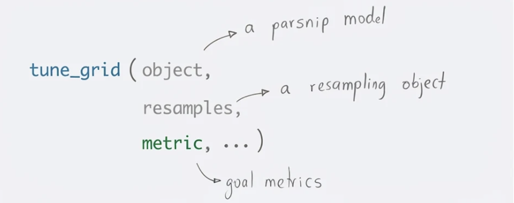{width="700" fig-align="center"}

## Ejemplo básico

```{r}
rf_tuner <- 
  rand_forest(mtry = tune(),
              min_n = tune(),
              trees = 50
              ) |> 
  set_engine("ranger") |> 
  set_mode("regression")

rf_wflow <- workflow() |> 
  add_recipe(rec1) |> 
  add_model(rf_tuner)

rf_tune_results <-
  rf_wflow |>
  tune_grid(resamples = folds,
            metrics = metric_set(rsq, mse))

show_best(rf_tune_results, metric = "mse")

show_best(rf_tune_results, metric = "rsq")

best_parameters <- select_best(rf_tune_results, metric = "mse") |>
  select(-.config)
best_parameters

best_workflow <- rf_wflow |>
  finalize_workflow(best_parameters) |>
  fit(train_data)

df <- tibble(
  actual = test_data$salario,
  predicted = predict(best_workflow, new_data = test_data)$.pred
)

ggplot(df, aes(x = actual, y = predicted)) +
  geom_point() +
  geom_abline()
```

<br><br>

{width="300"}

Realice el ejercicio 6 y 7 del [taller de word](https://github.com/fhernanb/taller_tidymodels_latinR/blob/main/taller_practico_penguins_tidymodels.docx).

<br><br>

------------------------------------------------------------------------

# Fin

{width="800" fig-align="center"}

{width="1000" fig-align="center"}

